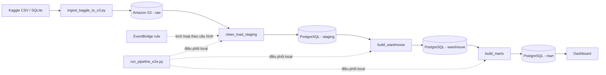

# CHƯƠNG 4: QUY TRÌNH TRÍCH XUẤT, BIẾN ĐỔI VÀ NẠP DỮ LIỆU (ETL/ELT)

## 4.1. Tổng quan pipeline

### 4.1.1. Mục tiêu

Pipeline dữ liệu có nhiệm vụ đưa bộ dữ liệu ngân hàng từ nguồn Kaggle vào PostgreSQL, chuyển đổi dữ liệu thành mô hình kho dữ liệu dạng Star Schema, sau đó tạo các Data Mart phục vụ phân tích. Quy trình cũng ghi nhận trạng thái xử lý, số lượng bản ghi và lỗi phát sinh để hỗ trợ kiểm tra.

### 4.1.2. Thứ tự các bước xử lý

Quy trình xử lý dữ liệu gồm các bước chính:

1. Tải bộ dữ liệu CSV/SQLite từ Kaggle về môi trường chạy.
2. Đưa các tệp nguồn lên Amazon S3 theo thư mục dữ liệu thô `raw/`.
3. Đọc dữ liệu từ S3, chuẩn hóa định dạng cơ bản và nạp vào các bảng staging trong PostgreSQL.
4. Làm sạch theo quy tắc nghiệp vụ, nạp các dimension rồi nạp các fact trong schema `warehouse`.
5. Tổng hợp dữ liệu warehouse thành các bảng trong schema `mart`.
6. Kiểm tra chất lượng và đối soát kết quả trước khi dashboard sử dụng.

Luồng dữ liệu tổng quát được mô tả như sau:



### 4.1.3. Phân loại ETL/ELT

Quy trình có đặc điểm kết hợp ETL và ELT. Python thực hiện trích xuất, chuẩn hóa một số định dạng và nạp dữ liệu vào staging. Các phép biến đổi nghiệp vụ, ánh xạ khóa dimension và tổng hợp Data Mart chủ yếu được thực hiện bằng SQL ngay trong PostgreSQL. Vì vậy, có thể mô tả chính xác đây là **ELT kết hợp tiền xử lý bằng Python**: dữ liệu được đưa vào lớp staging trước, sau đó phần lớn logic chuyển đổi được thực thi tại hệ quản trị cơ sở dữ liệu.

## 4.2. Trích xuất và lưu dữ liệu nguồn

### 4.2.1. Trích xuất từ Kaggle

Script `scripts/1_ingest_kaggle_to_s3.py` sử dụng Kaggle API để tải bộ dữ liệu tổng hợp về một thư mục tạm. Thông tin xác thực Kaggle và cấu hình AWS được đọc từ biến môi trường; script không ghi trực tiếp thông tin xác thực vào mã nguồn.

Sau khi tải và giải nén, script tìm các tệp CSV và SQLite. Các tệp CSV có sẵn được tải lên S3. Nếu không tìm thấy `transactions.csv` nhưng có tệp SQLite chứa bảng `transactions`, script đọc bảng này theo từng chunk 100.000 dòng và ghi lần lượt ra CSV để hạn chế mức sử dụng bộ nhớ.

### 4.2.2. Phân vùng và lưu trên S3

Dữ liệu được lưu theo cấu trúc Hive-style:

```text
raw/<table_name>/ingest_date=YYYY-MM-DD/<file_name>.csv
```

Ví dụ:

```text
raw/transactions/ingest_date=2026-10-14/transactions.csv
```

Ngày `ingest_date` được tạo theo thời điểm chạy, không phải ngày nghiệp vụ của giao dịch. Cấu trúc này giúp phân biệt dữ liệu theo bảng và ngày tiếp nhận.

### 4.2.3. Manifest và kiểm tra tệp

Sau khi tìm thấy tệp nguồn, script ghi nhận số dòng, kích thước tệp và mã SHA-256 vào manifest. Manifest có `batch_id`, thời điểm tiếp nhận, nguồn dữ liệu, trạng thái và thông tin của từng bảng; tệp manifest được lưu dưới `metadata/manifests/` trên S3.

Mã SHA-256 được tính trên tệp cục bộ trước khi tải lên. Trong code hiện tại chưa thấy bước tải lại object hoặc so sánh checksum phía S3 để xác minh nội dung sau upload. Ngoài ra, khóa S3 của dữ liệu chứa `ingest_date` nhưng không chứa `batch_id`; nếu chạy lại trong cùng ngày, object cùng đường dẫn có thể bị ghi đè dù manifest của mỗi lần chạy có mã batch khác nhau. Đây là điểm cần cân nhắc khi mở rộng lưu lịch sử nhiều batch.

## 4.3. Làm sạch và nạp staging

### 4.3.1. Cấu trúc staging

Schema `staging` gồm bảy bảng tương ứng với các nhóm dữ liệu nguồn:

| Bảng staging | Nội dung chính |
|---|---|
| `stg_customers` | Khách hàng, thông tin liên hệ và điểm tín dụng |
| `stg_accounts` | Tài khoản, chủ tài khoản, loại tài khoản và số dư |
| `stg_cards` | Thẻ và tài khoản liên quan |
| `stg_merchants` | Thương nhân và thành phố |
| `stg_branches` | Chi nhánh và người quản lý |
| `stg_loans` | Khoản vay, khách hàng, số tiền và lãi suất |
| `stg_transactions` | Giao dịch, tài khoản, thương nhân, số tiền và thời gian |

Các định nghĩa bảng được khai báo trong `sql/01_create_staging_tables.sql`. Lớp staging giữ cấu trúc gần với dữ liệu nguồn và là đầu vào cho bước xây dựng warehouse.

### 4.3.2. Chuẩn hóa dữ liệu

Trong `scripts/2_clean_load_staging.py`, hàm `clean_dataframe()` thực hiện các xử lý cơ bản trước khi nạp:

- Xóa khoảng trắng ở đầu và cuối các cột chuỗi.
- Chuyển các cột ngày về định dạng `YYYY-MM-DD`.
- Chuyển cột thời gian giao dịch về định dạng `YYYY-MM-DD HH:MM:SS`.
- Khai báo kiểu dữ liệu đọc cho một số trường như mã định danh, số tiền và điểm tín dụng.

Hàm này chủ yếu chuẩn hóa định dạng, chưa thực hiện đầy đủ các quy tắc kiểm tra nghiệp vụ. Một số cột ngày dùng `errors="coerce"`, nghĩa là giá trị ngày không hợp lệ được chuyển thành `NaT`; code chưa có cơ chế riêng để cách ly những dòng đó. Việc ép cột chuỗi bằng `astype(str)` cũng có thể biến giá trị thiếu thành chuỗi như `"nan"`, vì vậy xử lý null cần được kiểm tra cẩn thận trước khi coi staging là dữ liệu đã sạch hoàn toàn.

### 4.3.3. Nạp dữ liệu theo chunk

Với bảng `transactions`, code cấu hình `chunksize` bằng 250.000 dòng. File được đọc và nạp lần lượt theo chunk, tránh đưa toàn bộ bảng giao dịch vào bộ nhớ cùng lúc. Các bảng còn lại hiện được đọc và nạp nguyên một DataFrame.

Mỗi chunk sau chuẩn hóa được chuyển thành dữ liệu phân tách bằng tab trong bộ nhớ và nạp vào PostgreSQL bằng lệnh `COPY FROM STDIN`. Cách này giảm chi phí so với thực hiện từng câu lệnh `INSERT` cho từng dòng.

### 4.3.4. Hành vi nạp lại và đối soát staging

Trước khi nạp từng bảng, script thực hiện `TRUNCATE` bảng staging tương ứng. Do đó, staging hiện được nạp theo kiểu thay thế toàn bộ dữ liệu của bảng, không phải tích lũy các batch. Sau khi nạp xong từng bảng, code commit transaction và ghi số dòng đã nạp. Cuối quy trình, code truy vấn `COUNT(*)` của các bảng staging để hiển thị số dòng hiện có.

Các số đếm này hỗ trợ đối chiếu, nhưng code chưa tự động so sánh chúng với `record_count` trong manifest và làm pipeline thất bại khi số liệu không khớp. Staging cũng chưa có bước kiểm tra trùng lặp hoặc cách ly bản ghi lỗi trước khi nạp. Nếu một bảng gặp lỗi sau khi các bảng trước đó đã commit, rollback chỉ hoàn tác transaction đang mở; dữ liệu các bảng đã commit trước đó vẫn được giữ lại.

## 4.4. Xây dựng Warehouse

### 4.4.1. Khởi tạo schema và dimension ngày

Script `scripts/init_db.py` lần lượt tạo schema, bảng staging, bảng warehouse và các index được khai báo. Sau đó, hàm `populate_dim_date()` sinh lịch từ ngày 01/01/2018 đến ngày 31/12/2030 và nạp vào `warehouse.dim_date` theo nhóm 1.000 bản ghi mỗi lần gọi `execute_values`. `date_key` có dạng `YYYYMMDD`; dimension lưu thêm thứ, ngày trong tháng, tháng, quý, năm và cờ cuối tuần.

Việc nạp dimension ngày được thực hiện trong bước khởi tạo cơ sở dữ liệu, không nằm trong `sql/03_insert_dimensions.sql` hay bước build warehouse thông thường. Nếu dữ liệu có ngày nằm ngoài khoảng đã sinh, quy trình cần bổ sung phạm vi lịch tương ứng trước khi tạo khóa liên kết.

### 4.4.2. Nạp dimension

Quy trình chuyển đổi staging sang warehouse nạp các dimension trước fact để đảm bảo khóa tham chiếu có thể được tra cứu. Các bảng gồm `dim_customer`, `dim_account`, `dim_card`, `dim_merchant` và `dim_branch`; `dim_date` được nạp riêng như mô tả ở trên.

Trong quá trình nạp dimension, SQL thực hiện một số quy tắc nghiệp vụ: loại bỏ dòng thiếu mã định danh, chuẩn hóa chuỗi, kiểm tra một số miền giá trị và thay thế thuộc tính thiếu bằng giá trị mặc định. Các bản ghi `UNKNOWN` được thêm vào một số dimension để đại diện cho đối tượng không ánh xạ được. Với dimension có khóa nghiệp vụ trùng, các câu lệnh `ON CONFLICT ... DO UPDATE` cập nhật thuộc tính hiện có.

### 4.4.3. Nạp fact và ánh xạ khóa

Sau khi nạp dimension, dữ liệu được chuyển vào hai bảng fact:

- `fact_transactions`: grain một dòng cho mỗi giao dịch có `transaction_id`; lưu số tiền và các khóa ngày, khách hàng, tài khoản, thẻ, merchant, chi nhánh.
- `fact_loans`: grain một dòng cho mỗi khoản vay có `loan_id`; lưu số tiền vay, lãi suất và các khóa khách hàng, ngày bắt đầu, chi nhánh.

Đối với giao dịch, SQL lọc các dòng thiếu mã giao dịch, tài khoản, merchant, thời gian hoặc có `amount_usd` không dương. Khách hàng được tra thông qua quan hệ giữa giao dịch và tài khoản. Thẻ được suy ra từ tài khoản; trong trường hợp một tài khoản có nhiều thẻ, code hiện chọn thẻ có ngày hết hạn xa nhất. Nếu không tra được dimension, khóa `UNKNOWN` được sử dụng. Giao dịch trùng `transaction_id` không được nạp lại do `ON CONFLICT DO NOTHING`.

Đối với khoản vay, SQL lọc các dòng thiếu mã khoản vay, khách hàng hoặc ngày bắt đầu; số tiền phải dương và lãi suất không âm. Khách hàng và ngày bắt đầu được ánh xạ sang dimension tương ứng. Bản ghi khoản vay trùng `loan_id` được bỏ qua.

Nguồn hiện không cung cấp `branch_id` trực tiếp cho giao dịch hoặc khoản vay trong phần dữ liệu được sử dụng. Vì vậy `branch_key` của các fact hiện được gán về `UNKNOWN`; việc tồn tại khóa này trong mô hình chưa đồng nghĩa dữ liệu có thể phân tích chính xác theo chi nhánh.

### 4.4.4. Index và kiểm tra toàn vẹn

Các index trong `sql/05_create_indexes.sql` tập trung vào những khóa thường dùng khi lọc hoặc nối fact với dimension, gồm tài khoản, khách hàng, merchant, ngày và thời gian giao dịch; bảng khoản vay có index theo khách hàng và ngày bắt đầu. Các khóa ngoại được khai báo trong DDL của warehouse.

Bộ kiểm thử `tests/test_data_quality.py` kiểm tra sự tồn tại và số lượng tối thiểu của bảng, khóa chính không null và duy nhất, khóa ngoại không orphan, miền giá trị tài chính và đối soát một số Data Mart với fact nguồn.

### 4.4.5. Khác biệt giữa cách chạy local và Lambda

Script `scripts/3_build_warehouse.py` xóa dữ liệu fact và các dimension nghiệp vụ trước khi nạp lại, trong khi giữ `dim_date`; đây là cách chạy full refresh. Lambda `lambda/build_warehouse/lambda_function.py` chứa phiên bản SQL riêng, thực hiện upsert dimension và bỏ qua fact trùng nhưng không có cùng bước truncate. Vì vậy, hành vi hai cách chạy không hoàn toàn giống nhau và cần được thống nhất nếu dùng Lambda làm luồng vận hành chính thức.

Trong phiên bản mã nguồn hiện tại, chuỗi SQL nhúng trong Lambda warehouse có ký tự `z` thừa sau một câu lệnh `ON CONFLICT`. Cần loại bỏ ký tự này và kiểm thử handler trước khi kết luận Lambda warehouse có thể chạy thành công; nhận xét ở trên mô tả ý định logic trong mã, không phải kết quả xác nhận chạy trên AWS.

## 4.5. Xây dựng Data Mart

Các Data Mart được tạo từ warehouse bằng những câu lệnh `CREATE TABLE AS SELECT` trong `sql/06_create_data_marts.sql`. Mỗi lần chạy script, các bảng mart cũ bị xóa và tạo lại, do đó đây là cách làm mới toàn bộ mart.

| Data Mart | Grain và nguồn | Chỉ số/chuyển đổi chính |
|---|---|---|
| `customer_360` | Một dòng cho mỗi khách hàng khác `UNKNOWN`; kết hợp dimension khách hàng, tài khoản, fact giao dịch và fact khoản vay | Số tài khoản, tổng số dư, số giao dịch, tổng chi tiêu, giá trị giao dịch trung bình, ngày giao dịch gần nhất, số khoản vay, tổng số tiền vay, lãi suất trung bình; phân nhóm điểm tín dụng và phân khúc khách hàng theo ngưỡng trong SQL |
| `daily_branch_performance` | Thiết kế dự kiến là một dòng cho mỗi ngày và chi nhánh; nguồn gồm dimension ngày, dimension chi nhánh và fact giao dịch | Số giao dịch, tổng giá trị giao dịch và giá trị giao dịch trung bình theo ngày |
| `merchant_analytics` | Một dòng cho mỗi merchant; nguồn gồm dimension merchant và fact giao dịch | Số giao dịch, tổng doanh số, giá trị đơn hàng trung bình, nhỏ nhất/lớn nhất và phí interchange ước tính bằng 1,5% tổng doanh số |
| `credit_risk_monitoring` | Một dòng cho mỗi nhóm điểm tín dụng; nguồn gồm fact khoản vay và dimension khách hàng | Số khoản vay, tổng số tiền vay, khoản vay trung bình, lãi suất trung bình và doanh thu lãi hằng năm ước tính |

**Lưu ý về `daily_branch_performance`:** SQL hiện kết hợp ngày với danh sách chi nhánh bằng `CROSS JOIN`, sau đó nối fact giao dịch theo ngày mà không nối theo `branch_key`. Đồng thời `branch_key` trong fact giao dịch đang được gán `UNKNOWN`. Vì vậy số liệu giao dịch theo ngày có thể bị lặp trên nhiều chi nhánh; không nên diễn giải mart này như hiệu suất chi nhánh thực tế cho đến khi có khóa chi nhánh đáng tin cậy và sửa điều kiện join.

Các trường `total_loan_debt_usd` và doanh thu lãi trong mart được tính từ số tiền vay và lãi suất có trong dữ liệu. Do nguồn chưa thể hiện số dư nợ còn lại, trạng thái khoản vay hoặc lịch thanh toán, đây là chỉ số tính toán/ước tính từ dữ liệu hiện có, không nên gọi là dư nợ thực tế hay doanh thu thực tế của ngân hàng.

## 4.6. Tự động hóa pipeline

### 4.6.1. Thành phần Lambda

Trong thư mục `lambda/` có các handler cho những công đoạn sau:

- `clean_load_staging`: đọc object trên S3, chuẩn hóa dữ liệu cơ bản và nạp các bảng staging.
- `build_warehouse`: nạp dimension và fact bằng SQL.
- `build_marts`: tạo lại bốn Data Mart.
- `alert_on_failure`: định dạng và gửi thông báo trạng thái qua SNS khi có `AWS_SNS_TOPIC_ARN`.

Việc tải dữ liệu từ Kaggle hiện được thực hiện bởi `scripts/1_ingest_kaggle_to_s3.py`, không phải một Lambda handler trong thư mục trên.

### 4.6.2. Lập lịch và mức độ tự động hóa hiện tại

File `infrastructure/eventbridge_rule.json` mô tả lịch chạy hằng ngày lúc 02:00 UTC và target là Lambda `clean_load_staging`. ARN trong file còn chứa placeholder `YOUR_ACCOUNT_ID`. Cấu hình này thể hiện ý định lập lịch; riêng file cấu hình không chứng minh rằng rule đã được triển khai trên tài khoản AWS.

Trong cấu hình hiện có, EventBridge chỉ gọi Lambda nạp staging. Chưa thấy cấu hình nối tiếp staging → warehouse → mart, cũng chưa thấy target hoặc cơ chế bắt lỗi của rule gọi `alert_on_failure`. Do đó, không nên mô tả rằng toàn bộ chu trình đã được EventBridge tự động điều phối trên AWS.

Script `scripts/run_pipeline_e2e.py` là bộ điều phối end-to-end khi chạy local: gọi lần lượt các hàm staging, warehouse, mart, chạy kiểm tra chất lượng và gọi handler cảnh báo khi thành công hoặc thất bại. Đây là luồng local, khác với cấu hình EventBridge/Lambda hiện có.

### 4.6.3. Xử lý thành công và thất bại

Các handler trả kết quả thành công sau khi hoàn tất bước tương ứng; lỗi kết nối hoặc lỗi SQL được ghi log rồi ném lại để Lambda nhận biết lần chạy thất bại. Trong staging, số dòng đã nạp theo bảng được ghi vào log và response. Trong runner local, lỗi được gắn với tên stage hiện tại và gửi tới handler cảnh báo. Handler SNS hỗ trợ thông báo thành công, lỗi pipeline và cảnh báo chất lượng; nếu chưa cấu hình ARN topic, nội dung thông báo chỉ được in ra log thay vì gửi tới SNS.

## 4.7. Logging và xử lý lỗi

### 4.7.1. Thông tin được ghi nhận

Các script local ghi thời gian bắt đầu, tên bảng, batch date, số dòng, thời gian xử lý và kết quả. Script ingestion còn ghi `batch_id`, số dòng nguồn, kích thước và checksum vào manifest. Các Lambda sử dụng Python logging với mức `INFO`, ghi số dòng nạp, số dòng warehouse hoặc mart và chi tiết exception kèm stack trace khi có lỗi.

### 4.7.2. Tra cứu log CloudWatch

Khi Lambda được triển khai và thực thi, có thể xem log trong AWS Console theo đường dẫn: **Lambda → chọn function → Monitor → View CloudWatch logs**. Mỗi lần gọi Lambda thường tương ứng với một log stream; cần đối chiếu timestamp, request ID, tên stage và thông báo exception để xác định bước phát sinh lỗi. Log của script chạy local nằm ở terminal nơi lệnh được thực hiện, không tự động xuất hiện trong CloudWatch trừ khi có cấu hình gửi log riêng.

### 4.7.3. Cơ chế rollback và giới hạn

Các bước ghi PostgreSQL bật transaction và gọi `rollback()` khi gặp exception. Tuy nhiên, staging commit sau mỗi bảng; vì vậy rollback khi bảng sau lỗi không hoàn tác các bảng đã commit trước đó. Quy trình hiện chưa cung cấp checkpoint thống nhất cho toàn bộ pipeline.

Trong cấu hình repo đã kiểm tra, chưa thấy khai báo retry/DLQ, CloudWatch alarm, hoặc cơ chế điều phối AWS bảo đảm các Lambda chạy theo thứ tự và tự dừng chuỗi khi một stage lỗi. Đây là các hạng mục có thể đề xuất bổ sung, không nên trình bày như chức năng đã triển khai. Các cải tiến phù hợp gồm lưu trạng thái từng batch vào control table, chỉ đánh dấu batch thành công sau khi đối soát, thêm retry có giới hạn/DLQ và nối các bước bằng Step Functions hoặc một cơ chế điều phối tương đương.

### 4.7.4. Kiểm thử chất lượng dữ liệu

Bộ `tests/test_data_quality.py` có bảy nhóm kiểm tra chính: số lượng bảng, sự tồn tại và số dòng mart, tính duy nhất/không null của khóa chính, toàn vẹn khóa ngoại, miền giá trị của số tiền/lãi suất/điểm tín dụng và đối soát một số mart với fact. Các kiểm tra có thể chạy trong luồng end-to-end local qua `scripts/run_pipeline_e2e.py`; việc có mã kiểm thử trong repo không tự nó chứng minh rằng chúng đã chạy thành công trên môi trường AWS.

## Kết luận chương

Chương này đã trình bày luồng dữ liệu từ Kaggle qua S3 và staging đến warehouse, Data Mart và kiểm thử. Python đảm nhiệm trích xuất, chuẩn hóa định dạng và nạp theo chunk; SQL trong PostgreSQL thực hiện phần lớn quy tắc chuyển đổi nghiệp vụ. Pipeline local có bộ điều phối end-to-end, trong khi cấu hình AWS hiện mô tả EventBridge gọi Lambda staging và chưa thể hiện đầy đủ việc điều phối tất cả các bước. Các giới hạn về full refresh, xử lý null/trùng lặp, kiểm tra checksum sau upload, ánh xạ chi nhánh và nhất quán giữa local với Lambda cần được xem xét khi đánh giá kết quả và đề xuất hướng phát triển.