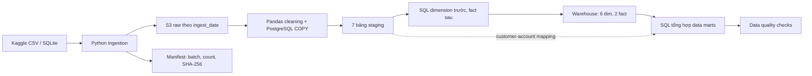

# Kịch bản bảo vệ dự án: Data Ingestion và Data Engineering

> **Bản đọc thuyết trình và demo local hiện hành:** [loi_thuyet_trinh_va_demo_local.md](loi_thuyet_trinh_va_demo_local.md). Tài liệu bên dưới giữ lại phần review và câu hỏi kỹ thuật để tra cứu; bài nói chính dùng bản local theo phạm vi đã chốt.

> **Cập nhật sau sửa lỗi:** lỗi unit test ngày hỗn hợp, import tên script cũ và pin dependency trùng đã được sửa. Đã chạy 14 unit test đạt (9 cleaning, 5 runner giả lập). Các phát hiện trong bảng review bên dưới phản ánh thời điểm trước sửa; các giới hạn liên quan SQL, database/AWS vẫn chưa được xác minh bằng chạy thực tế.

Ngày review: 06/11/2026. Phạm vi: source Python tự viết trong scripts, lambda, tests, dashboard; toàn bộ SQL; cấu hình infrastructure và dependencies. Không review mã thư viện trong venv/scratch_layer. Power BI nằm ngoài phạm vi báo cáo này.

Đã đọc source và kiểm tra cú pháp 21 file Python; chạy riêng unit test cleaning: **2 passed, 1 failed**. Chưa chạy ingestion, pipeline ghi dữ liệu, kiểm thử DB hay kiểm chứng tài nguyên AWS đang triển khai. Số dòng ghi trong comment/test là kỳ vọng, không phải số liệu đo của phiên review.

## 1. Thông điệp xuyên suốt

> Dự án xây dựng pipeline batch đưa dữ liệu ngân hàng tổng hợp từ Kaggle vào S3, chuẩn hóa và nạp PostgreSQL staging, biến đổi theo mô hình chiều, sau đó tổng hợp thành data marts. Trọng tâm là tổ chức dữ liệu, xử lý khối lượng giao dịch theo chunk, bulk load, bảo toàn quan hệ và kiểm định số liệu.

Mạch nói: **bài toán → nguồn và grain → ingestion có truy vết → chuẩn hóa và nạp → mô hình chiều → query tổng hợp → kiểm định → giới hạn và cải tiến**.

Không mở đầu bằng danh sách dịch vụ AWS. Bắt đầu bằng dữ liệu đầu vào và câu hỏi đầu ra.

Manifest hiện là đầu ra phục vụ audit; staging chưa đọc manifest để chặn batch thiếu hoặc đối soát checksum. Customer 360 vẫn cần mapping từ staging.

## 2. Review: các điểm phải nắm trước khi lên báo cáo

| Mức ưu tiên | Phát hiện có bằng chứng | Ảnh hưởng và hướng xử lý đề xuất |
|---|---|---|
| Cao | `sql/06_create_data_marts.sql:131–138`: CROSS JOIN tối đa 50 branch rồi JOIN fact chỉ bằng date_key | Mỗi branch nhận tổng giao dịch toàn hệ thống của ngày đó. Không dùng mart này để so sánh chi nhánh. Cần join cả branch_key, nhưng còn phải giải quyết thiếu branch mapping trong nguồn. |
| Cao | `scripts/2_clean_load_staging.py:117`; `tests/test_clean_logic.py:37` | Test ngày hỗn hợp thất bại: `15-08-2023` thành giá trị thiếu. Cần hợp đồng định dạng ngày, parse tường minh và kiểm đếm lỗi; không chỉ coerce rồi im lặng bỏ qua. |
| Cao | `scripts/3_build_warehouse.py:55–78` commit sau truncate, dim và fact; staging commit mỗi bảng ở dòng 186 | Rollback không khôi phục được các bước đã commit. Có thể tồn tại staging nhiều batch hoặc warehouse rỗng/dở dang sau lỗi. Đề xuất bảng batch tạm, kiểm định rồi publish trong transaction phù hợp. |
| Cao | `requirements.txt` pin hai phiên bản khác nhau của boto3, psycopg2-binary, python-dotenv | Không thể đồng thời thỏa mãn các pin trực tiếp này khi cài mới. Cần gộp một phiên bản/package và kiểm chứng môi trường sạch. Không đồng nhất việc venv hiện có chạy được với khả năng tái lập cài đặt. |
| Cao | `scripts/1_ingest_kaggle_to_s3.py:156`; staging chọn partition từ branches ở dòng 23 | Cùng ngày dùng lại object key; batch_id không nằm trong raw key. Batch sau có thể ghi đè; staging không kiểm tra manifest SUCCESS. Nên dùng batch_id trong đường dẫn và chuyển manifest/key cụ thể giữa các bước. |
| Cao | `lambda/ingest_kaggle_to_s3/lambda_function.py` rỗng; EventBridge chỉ trỏ clean_load_staging, có YOUR_ACCOUNT_ID | Repo chưa mô tả đủ chuỗi cloud chạy toàn bộ ingestion → quality. Không suy ra deployment thực tế chỉ từ repo; nếu có AWS đã cấu hình bên ngoài, cần log/execution riêng. |
| Trung bình | Local warehouse truncate; Lambda warehouse ở dòng 323 trở đi không truncate, dim upsert và fact DO NOTHING | Local là rebuild; Lambda giữ fact cũ và bỏ qua ID cũ. Nguồn sửa/xóa giao dịch sẽ không được phản ánh đầy đủ trên Lambda. Đây chưa phải CDC/incremental pipeline hoàn chỉnh. |
| Trung bình | `sql/04_insert_facts.sql:46–51` chọn một card theo expiration_date | Chống nhân dòng do account có nhiều thẻ, nhưng không xác định thẻ thực sự dùng giao dịch. DESC mặc định có thể ưu tiên NULL; hòa ngày thiếu tie-breaker. Cần nguồn card_id thật hoặc ghi rõ inferred mapping. |
| Trung bình | Cùng SQL dòng 35 và 105 gán branch UNKNOWN | Không đủ bằng chứng gọi đó là giao dịch online; UNKNOWN chỉ có nghĩa chưa ánh xạ được. Tương tự customer UNKNOWN không tự chứng minh là khách vãng lai. |
| Trung bình | Ngày fallback tạo YYYYMMDD nhưng dim_date chỉ có 2018–2030 | Ngày ngoài lịch vẫn vi phạm FK; tạo số key không tạo bản ghi dimension. Cần mở rộng lịch hoặc chính sách reject/unknown date. |
| Trung bình | Dim credit_score lỗi được gán -1, nhưng test tài chính yêu cầu mọi customer thật thuộc 300–850 | Chính sách cleaning và kiểm thử mâu thuẫn. Loader chấp nhận loan interest_rate >= 0, test lại giới hạn <= 40. Cần thống nhất quy tắc. |
| Trung bình | `customer_360` đặt tên active_loans_count/total_loan_debt_usd nhưng nguồn không có trạng thái trả nợ | Thực chất đếm hợp đồng và cộng loan_amount đầu vào; chưa chứng minh khoản vay đang hoạt động hoặc dư nợ còn lại. |
| Trung bình | `lambda/build_marts/lambda_function.py` trả dict statusCode 500 khi exception | Với invocation Lambda thông thường, trả payload 500 không đồng nghĩa phát sinh function error. Nếu điều phối dựa trên exception phải raise hoặc kiểm tra payload rõ ràng. |
| Trung bình | Quality chạy sau khi marts đã commit | Hiện là phát hiện/cảnh báo sau nạp, chưa phải cổng ngăn publish dữ liệu lỗi. Test chưa đối soát branch mart và tổng tiền xuyên tầng. |
| Thấp | `sql/02_create_warehouse_tables.sql:2` DROP SCHEMA CASCADE; init_db autocommit và chỉ in lỗi | Không chạy init_db để demo trên kho dữ liệu cần giữ. Đây là script khởi tạo có tính phá hủy, không phải migration an toàn. |

Các giới hạn ingestion bổ sung: chưa kiểm tra bắt buộc đủ đúng 7 bảng trước SUCCESS; source filename giữ nguyên nhưng staging yêu cầu `<table>.csv`; scan partition chưa có paginator; đếm dòng vật lý không đúng cho CSV có newline trong ô; checksum chưa được kiểm lại downstream; code chạy tuần tự dù phần mô tả có chữ “song song”. Không dùng các khẳng định “nhanh hơn 10 lần” trong comment làm benchmark.

Review bổ sung phần phụ trợ: dashboard Streamlit đọc toàn bộ marts và cache 600 giây, nên nhãn “Real-time” không chứng minh cập nhật thời gian thực. Một số nhãn KYC/YoY là nội dung cố định; tổng volume từ branch mart kế thừa lỗi cộng lặp, trung bình các avg_ticket_size/avg_interest_rate không có trọng số có thể sai. Filter loại UNKNOWN merchant bằng tên không khớp tên placeholder hiện tại. requirements gốc còn thiếu streamlit/plotly dù dashboard import chúng; requirements Lambda staging rỗng. Các shell deploy/layer/teardown, phần lớn docs kiến trúc và notebook hiện rỗng. Các điểm này không đưa vào phần Power BI.

## 3. Flow thuyết trình khoảng 18 phút

Phần nói khoảng 15 phút; dành thêm 3 phút chạy các query minh chứng Q01–Q04 đã chuẩn bị sẵn.

### Chặng 1 — Bài toán và kết quả mong muốn (1 phút)

Nói:

> Dữ liệu khách hàng, tài khoản, thẻ, giao dịch và khoản vay nằm ở nhiều bảng nguồn. Để trả lời khách nào có giá trị cao, merchant nào có nhiều giao dịch và danh mục vay phân bổ thế nào theo điểm tín dụng, nhóm xây dựng pipeline thống nhất nguồn, chuẩn hóa dữ liệu và tạo tầng tổng hợp bằng SQL.

**Nhấn:** dữ liệu synthetic phục vụ học tập; kết quả hiện tại chốt ở data marts và truy vấn kiểm chứng.

Chuyển: “Đầu tiên em xác định nguồn dữ liệu và mức chi tiết của từng bảng.”

### Chặng 2 — Nguồn dữ liệu, quan hệ và grain (1,5 phút)

Mở `scripts/2_clean_load_staging.py:40` (TABLE_CONFIGS) và `sql/01_create_staging_tables.sql`.

| Bảng nguồn | Một dòng biểu diễn | Quan hệ dùng trong pipeline |
|---|---|---|
| customers | Một khách hàng | customer_id liên kết accounts và loans |
| accounts | Một tài khoản | customer_id; account_id liên kết transactions/cards |
| cards | Một thẻ | account_id |
| merchants | Một đơn vị chấp nhận giao dịch | merchant_id |
| branches | Một chi nhánh trong danh mục | Chưa có mapping branch cho giao dịch/vay trong code nguồn |
| loans | Một hợp đồng vay | customer_id |
| transactions | Một giao dịch | account_id và merchant_id |

Nói: “Em xác định grain trước khi JOIN để bảo đảm một giao dịch chỉ sinh một dòng fact.”

**Nhấn:** một account có thể có nhiều card; JOIN thẳng cards có thể nhân số giao dịch. Số lượng 1 triệu transactions là kỳ vọng trong source/tests; khi báo cáo dùng COUNT thực tế từ DB.

### Chặng 3 — Ingestion từ Kaggle tới S3 (3 phút, trọng tâm)

Mở `scripts/1_ingest_kaggle_to_s3.py`, đi đúng thứ tự:

1. Dòng 94: `download_kaggle_dataset()` gọi API download và unzip.
2. Dòng 104: `discover_source_files()` tìm CSV/SQLite trong thư mục tải về.
3. Dòng 114: nếu thiếu transactions.csv và có SQLite, tìm bảng transactions và export theo chunk **100.000 dòng**.
4. Dòng 144: upload CSV vào `raw/<table>/ingest_date=YYYY-MM-DD/<file>.csv`.
5. Dòng 69 và 195: SHA-256 đọc khối 1 MiB và manifest JSON ghi metadata.
6. Dòng 209: hàm điều phối tạo batch ID, ghi trạng thái và upload manifest trong finally.

Lời nói mẫu:

> Ingestion giữ dữ liệu nguồn trong S3 để tách việc thu thập khỏi biến đổi. Nếu giao dịch không được cung cấp bằng CSV, code trích xuất từ SQLite theo từng chunk 100.000 dòng. Mỗi lần chạy có batch ID và manifest chứa đường dẫn, số dòng, dung lượng và SHA-256, giúp truy vết những file đã upload.

**Nhấn ba ý:** tách raw khỏi dữ liệu phục vụ phân tích; đọc chunk thay vì giữ toàn bộ bảng transactions trong RAM; audit theo batch.

Nếu bị hỏi “checksum bảo đảm end-to-end chưa?”, trả lời: “Hiện checksum được tính trước upload và ghi vào manifest; bước staging chưa kiểm lại, nên chưa thể khẳng định xác thực toàn vẹn xuyên suốt.”

Nếu bị hỏi “partition có tăng tốc query PostgreSQL không?”, trả lời: “Đây là tổ chức object key của S3 để chọn batch; PostgreSQL chưa được partition table trong DDL.”

Chuyển: “Sau khi có dữ liệu raw, bước tiếp theo là chuẩn hóa và nạp staging.”

### Chặng 4 — Cleaning và bulk load staging (2,5 phút, trọng tâm)

Mở `scripts/2_clean_load_staging.py:107`, rồi dòng 127 và 137.

Nói:

> TABLE_CONFIGS mô tả kiểu dữ liệu, cột ngày và cột cần nạp của từng bảng. Cleaning chuẩn hóa chuỗi và ngày; dữ liệu transactions được đọc từ S3 theo chunk 250.000 dòng. Mỗi chunk được ghi vào StringIO rồi nạp bằng COPY FROM STDIN, thay vì gửi từng INSERT riêng lẻ.

Giải thích `na_rep='\\N'` đi cùng `NULL '\\N'`: truyền giá trị thiếu sang PostgreSQL; không phải mọi chuỗi rỗng đều tự thành NULL.

**Nhấn:** chunk 100k ở SQLite export và chunk 250k ở S3 → staging là hai bước khác nhau. Chunk giới hạn phần DataFrame đang xử lý, không có nghĩa toàn bộ hệ thống luôn chỉ dùng từng ấy RAM: còn có buffer CSV và các bản sao khi biến đổi.

Nói rõ transaction: “Mỗi bảng staging được truncate và nạp trong một transaction, rồi commit; cả bảy bảng chưa phải một transaction chung.”

Khi đề cập chất lượng ngày: chỉ ra unit test thất bại hiện tại. Đây là giới hạn đã phát hiện; không nói cleaning xử lý mọi định dạng.

Chuyển: “Staging phục vụ tiếp nhận; warehouse mới áp dụng các quy tắc nghiệp vụ và khóa phân tích.”

### Chặng 5 — Warehouse và SQL transformation (3 phút, trọng tâm)

Mở theo thứ tự:

- `sql/02_create_warehouse_tables.sql:24`: natural key customer_id và surrogate key customer_key; fact dùng foreign key.
- `sql/03_insert_dimensions.sql:51`: CTE validated_customers, chuẩn email, tên, điểm tín dụng.
- `sql/04_insert_facts.sql:6`: valid_transactions → unknown_keys → enriched_transactions → INSERT.
- `sql/04_insert_facts.sql:46`: chọn một card/account bằng DISTINCT ON.

Nói:

> Warehouse có sáu dimension và hai fact. Grain fact_transactions là một giao dịch theo transaction_id; grain fact_loans là một hợp đồng theo loan_id. Em nạp dimension trước để fact tra cứu surrogate key. Các bản ghi có ID nhưng chưa tra được dimension được gán UNKNOWN thay vì bị mất do INNER JOIN; các bản ghi vi phạm điều kiện bắt buộc vẫn bị loại ở CTE validation.

**Nhấn sự phân biệt:** missing ID bị lọc khác với có ID nhưng không lookup được. FK hợp lệ chỉ chứng minh tham chiếu tới dimension tồn tại, chưa chứng minh mapping đúng nghiệp vụ.

Giải thích SQL bằng một ví dụ giả định, không nhận là dữ liệu thật: transaction T1 → account A1 → customer C1 → customer_key 15; merchant M1 → merchant_key 7; account có hai card thì chỉ lấy một card đại diện. Branch hiện UNKNOWN vì thiếu liên kết nguồn.

Về ETL/ELT:

> S3 → staging có transform bằng Python trước load, mang tính ETL. Staging → warehouse → marts dùng SQL trong PostgreSQL sau khi dữ liệu đã được nạp, mang tính ELT. Dự án kết hợp hai cách theo từng tầng.

Về lịch sử: “Local rebuild không lưu lịch sử dimension kiểu SCD2. Lambda có upsert dimension gần với cập nhật trạng thái hiện tại, cũng chưa phải SCD2.”

### Chặng 6 — Data marts và query có ý nghĩa (2 phút)

Mở `sql/06_create_data_marts.sql:14`.

> Customer 360 tổng hợp accounts, transactions và loans riêng theo khách hàng rồi mới JOIN. Việc này tránh nhân số tiền khi một khách có nhiều tài khoản, giao dịch và khoản vay.

Ví dụ dễ nói: 2 transactions và 3 loans nếu JOIN trực tiếp theo customer có thể tạo 6 dòng; SUM transaction bị lặp 3 lần. Aggregate mỗi nhánh về 1 dòng/customer trước JOIN giải quyết sự nhân dòng này.

**Điểm code đáng trình bày nhất:** ba CTE customer_accounts, customer_spending, customer_loans và các LEFT JOIN cuối câu.

Mở dòng 152: merchant analytics giữ cả merchant chưa phát sinh giao dịch bằng LEFT JOIN; COUNT(t.transaction_key) cho 0 thay vì COUNT(*) cho 1 trên dòng LEFT JOIN không khớp.

Mở dòng 180: credit mart gom khoản vay theo nhóm điểm tín dụng. Đây là phân bố danh mục theo score, chưa có dữ liệu quá hạn/default để đo rủi ro thực tế. Phí 1,5% ở merchant là giả định tính toán, không phải doanh thu thực thu.

Branch mart: nêu rõ giới hạn join, không đưa bảng xếp hạng chi nhánh làm kết quả nghiệp vụ.

### Chặng 7 — Quality, orchestration và minh chứng (1,5 phút)

Mở `tests/test_data_quality.py`, sau đó `scripts/run_pipeline_e2e.py:63`.

> Bộ kiểm định có bảy nhóm: số dòng warehouse, số dòng mart, khóa chính, tham chiếu transaction, tham chiếu loan, miền giá trị và đối soát mart. Runner local gọi tuần tự staging → warehouse → marts → quality và notifier. Bước Kaggle → S3 chạy riêng.

**Nhấn:** 7 nhóm kiểm định không phải 7 dòng SQL và cũng chưa bao phủ tất cả sai lệch. Chưa có check branch mart, chưa đối soát đầy đủ tổng tiền, chưa dùng manifest làm chuẩn số dòng.

Chỉ nói “7/7 đạt” sau khi chạy thật trên dữ liệu hiện tại. Email success chứa số dòng và 7/7 dạng hard-code ở notifier, không dùng email đó làm nguồn đo độc lập.

### Chặng 8 — Kết quả và hướng phát triển (0,5 phút)

> Kết quả chính là pipeline batch nhiều tầng, có raw storage, chunked processing, COPY bulk load, mô hình chiều và SQL tổng hợp kèm bộ kiểm định. Hướng hoàn thiện ưu tiên là sửa query chi nhánh, thống nhất parsing và kiểm thử, ràng buộc batch bằng manifest, rồi đồng bộ hành vi local/Lambda và bổ sung điều phối cloud.

Nếu chỉ có 10 phút: bài toán 0,5; nguồn 0,5; ingestion 2; staging 1,5; warehouse 2; marts 1,5; quality và giới hạn 2.

## 4. Bộ câu hỏi phản biện và câu trả lời

### Ingestion và vận hành

**1. Vì sao không nạp thẳng Kaggle vào database?**

S3 lưu bản nguồn theo lần thu thập và tách phụ thuộc nguồn khỏi bước xử lý. Có thể chạy lại transformation từ raw. Tuy nhiên cùng ngày đang ghi đè cùng key nên khả năng replay từng batch trong ngày chưa được bảo đảm.

**2. Đây là batch hay streaming?**

Batch: tải dataset, xử lý file, nạp theo đợt. Không có consumer streaming hay CDC trong luồng chính.

**3. Batch ID khác ingest_date thế nào?**

ingest_date nhóm theo ngày tải; batch_id phân biệt lần chạy. Ngày tải không phải ngày phát sinh giao dịch. Hiện batch_id ở manifest nhưng chưa ở raw path.

**4. Chạy lại có bị trùng không?**

Local truncate/rebuild tránh tích lũy dòng cũ; fact UNIQUE + DO NOTHING tránh lặp ID khi insert. Chưa đủ để gọi toàn hệ thống idempotent: surrogate key/loaded_at thay đổi, raw có thể ghi đè, Lambda bỏ qua cập nhật fact cũ.

**5. Một bảng upload lỗi thì sao?**

Manifest có thể FAILED và ghi được các bảng đã upload thành công; các file đã upload không tự rollback. Staging hiện không đòi manifest SUCCESS nên còn nguy cơ đọc batch thiếu hoặc trộn file cùng ngày.

**6. Chứng minh hệ thống tự động trên AWS bằng gì?**

Execution/log CloudWatch, cấu hình trigger và từng trạng thái phụ thuộc trong môi trường thật. Repo hiện chỉ có template EventBridge trỏ staging; Lambda ingestion và script deploy còn rỗng. Không lấy sơ đồ hoặc comment làm bằng chứng chạy thật.

**7. Tại sao chưa dùng Spark?**

Code hiện xử lý theo chunk bằng pandas và bulk load PostgreSQL. Để quyết định đổi công cụ phải đo thời gian, RAM và throughput ở khối lượng mục tiêu; repo chưa có benchmark chứng minh phân tán là cần thiết.

**8. Vì sao COPY? Chunk lớn bao nhiêu là tốt?**

COPY phục vụ nạp nhiều dòng, giảm số lần gửi từng INSERT. Chunk hiện là cấu hình thực nghiệm 100k/250k; chưa có benchmark để gọi tối ưu. Đo records/second, peak RAM và thời gian DB để điều chỉnh.

### SQL và mô hình dữ liệu

**9. Fact khác dimension và grain là gì?**

Fact lưu sự kiện/số đo, dimension cung cấp ngữ cảnh. Grain là ý nghĩa của một dòng. Không trộn một dòng giao dịch với một dòng hợp đồng vay trong cùng fact.

**10. Tại sao dùng surrogate key khi đã có ID nguồn?**

Tách khóa nội bộ warehouse khỏi khóa nghiệp vụ, fact tham chiếu thống nhất vào dimension. Dự án chưa tận dụng khóa này để quản lý nhiều phiên bản lịch sử; local rebuild còn làm thay đổi surrogate key giữa các lần chạy.

**11. LEFT JOIN hay INNER JOIN trong fact?**

LEFT JOIN giữ giao dịch qua bước lookup nếu ID không khớp dimension, sau đó COALESCE về UNKNOWN. INNER JOIN sẽ làm mất những dòng đó. Validation vẫn loại giao dịch thiếu trường bắt buộc hoặc amount <= 0.

**12. UNKNOWN có chứng minh là khách ngoài hệ thống không?**

Không. Có thể do thiếu master data, ID sai hoặc đồng bộ trễ. Cần nguyên nhân/quality flag để phân biệt; label External trong code chỉ là nhãn thay thế.

**13. CROSS JOIN unknown_keys có làm nhân dòng không?**

CTE này SELECT các scalar subquery, kỳ vọng trả đúng một dòng bộ khóa, nên không nhân số transaction. Khác CROSS JOIN date × nhiều branch tạo nhiều tổ hợp.

**14. Vì sao DISTINCT ON khi lấy card?**

Đưa mỗi account về một dòng để tránh nhân fact. ORDER BY chọn expiration_date mới nhất theo quy tắc hiện tại. Đây chỉ là card đại diện; nên có NULLS LAST và tie-breaker rõ ràng nếu giữ quy tắc này, còn để xác định thẻ thực dùng phải có card_id ở giao dịch.

**15. Có ON CONFLICT thì dữ liệu luôn đúng chứ?**

Không. DO NOTHING chỉ bỏ ID trùng, không cập nhật amount đã sửa. DO UPDATE dimension cũng không khử trùng nguồn trước insert; nhiều dòng cùng natural key trong cùng lệnh có thể gây lỗi. Cần chính sách dedup và lấy bản ghi thắng rõ ràng.

**16. Vì sao Customer 360 aggregate trước JOIN?**

Tránh fan-out giữa các quan hệ một-nhiều. Mỗi nhánh về một dòng/customer rồi mới ghép. Nếu staging accounts đã có duplicate ID thì ngay CTE accounts vẫn có thể cộng lặp, nên nguồn phải được kiểm uniqueness.

**17. COUNT(*) và COUNT(transaction_key) khác gì?**

COUNT(*) đếm cả dòng giữ lại từ phía dimension trong LEFT JOIN; COUNT(transaction_key) chỉ đếm giá trị không NULL, nên merchant không có giao dịch nhận 0.

**18. COALESCE và NULLIF dùng làm gì?**

NULLIF(TRIM(value), '') chuyển chuỗi rỗng thành NULL; COALESCE chọn giá trị thay thế. Không được coi missing balance và balance thật bằng 0 là tương đương về nghiệp vụ chỉ vì phép tính đã thay NULL bằng 0.

**19. CTE có tự tăng tốc không?**

Trong dự án CTE chủ yếu làm rõ các bước validation/enrichment/aggregation. Muốn kết luận tốc độ phải xem execution plan và đo, không căn cứ số lượng CTE.

**20. Index có chắc giúp query GROUP BY toàn bảng không?**

Không chắc; query đọc phần lớn dữ liệu có thể chọn sequential scan. Dùng EXPLAIN ANALYZE BUFFERS trên query SELECT để xem actual rows, thời gian, join và I/O. Có index không đồng nghĩa planner sẽ dùng.

**21. Tại sao không lấy trung bình của các trung bình merchant?**

Merchant có số giao dịch khác nhau. Trung bình toàn hệ thống = tổng volume / tổng count, không phải AVG(avg_order_value_usd). Tránh dùng trung bình đã làm tròn khi có thể tính từ sum/count gốc.

**22. Balance có cộng qua mọi chiều thời gian được không?**

Không. Balance là trạng thái tại thời điểm, cộng các snapshot qua nhiều ngày dễ đếm lặp. Hiện balance nằm ở dim_account và phản ánh snapshot nguồn, chưa có periodic snapshot fact để truy lịch sử số dư.

**23. Loan debt và active loan có đúng tên không?**

Tên hiện tại vượt quá ý nghĩa nguồn. Loan_amount chưa trừ hoàn trả nên chưa phải dư nợ còn lại; không có status/end_date nên chưa xác định active. Khi nói dùng “tổng giá trị khoản vay trong dữ liệu” và “số hợp đồng”.

**24. Phí merchant và doanh thu lãi có phải số thực thu?**

Không. Phí dùng volume × 1,5%; lãi dùng loan_amount × rate/100. Đều là ước tính theo giả định, chưa tính lịch trả nợ, dư nợ biến đổi, chi phí hoặc khoản thu thực tế.

**25. Branch mart sai chỗ nào? Sửa mỗi JOIN đã đủ chưa?**

JOIN chỉ date nên lặp tổng toàn ngày cho từng branch. Thêm branch_key sửa logic liên kết, nhưng fact gốc đều UNKNOWN branch thì các branch thật vẫn không có số giao dịch. Cần bổ sung mapping nguồn hoặc chỉ báo cáo theo ngày/toàn hệ thống.

**26. Vì sao FK không lỗi nhưng kết quả vẫn sai?**

FK chỉ kiểm key có tồn tại. Mapping customer/account ngẫu nhiên hoặc sai vẫn có thể tham chiếu hợp lệ. Cần kiểm quan hệ nghiệp vụ và đối soát tổng tiền, không chỉ đếm orphan.

### Chất lượng và giới hạn

**27. Làm sao biết không mất dữ liệu?**

Cần cân bằng: số dòng raw → staging → hợp lệ → bị loại/trùng → fact; cộng thêm đối soát số tiền theo cùng phạm vi. Hiện repo có count và một số đối soát mart nhưng chưa có đầy đủ rejected-record ledger và manifest reconciliation.

**28. 7/7 test pass có chứng minh đúng toàn bộ không?**

Không. Test chỉ kiểm những điều đã viết. Branch mart có thể sai dù các check hiện tại vẫn pass. Unit cleaning vừa chạy còn 1 fail; không gộp kết quả này với DB integration tests chưa chạy.

**29. Test fail có ngăn mart lỗi đến người dùng không?**

Chưa: runner kiểm tra sau build_marts đã commit. Hướng cải tiến là build vào vùng tạm, kiểm định rồi mới publish.

**30. Script demo incremental có phải ingestion thật không?**

Không. `scripts/demo_incremental_batch.py` tự tạo transaction rồi insert trực tiếp fact, bỏ qua Kaggle/S3/staging và rebuild marts. Nó chứng minh thao tác append demo, không chứng minh incremental ingestion xuyên suốt; key được chọn độc lập nên chưa bảo đảm customer-account-card đúng quan hệ.

## 5. Demo SQL và chuẩn bị trước buổi báo cáo

File đi kèm: `sql/07_presentation_readonly_queries.sql`. Chạy từng query trên database đã có dữ liệu; toàn bộ được bọc transaction READ ONLY. File chưa được thực thi trên DB trong phiên review.

Thứ tự demo khuyến nghị:

1. Q01: cho thấy số dòng ở từng tầng, dùng số thực tế để nói quy mô.
2. Q02: truy vết một transaction từ ID nguồn tới các dimension.
3. Q03: giải thích dữ liệu thiếu mapping bằng tỷ lệ UNKNOWN.
4. Q04: đối soát count và tổng tiền merchant mart với fact.
5. Q05: query doanh số theo tháng, giải thích lọc khoảng thời gian.
6. Q06: top 3 merchant/tháng bằng window function nếu được hỏi sâu SQL.
7. Q07: minh chứng lỗi branch join, để giải thích giới hạn khi bị hỏi.
8. Q08–Q12: validation, duplicates, date ngoài lịch, trung bình có trọng số và quan hệ customer-account phục vụ phản biện.

Mở sẵn tab source: ingestion → cleaning → warehouse DDL → fact SQL → mart SQL → quality tests. Không cuộn từ đầu file trong lúc nói; dùng Ctrl+G hoặc tìm tên hàm/CTE.

Chuẩn bị ảnh/log thực tế về một manifest, danh sách object S3, số dòng DB và kết quả quality. Che thông tin tài khoản và thông tin kết nối nếu chia sẻ màn hình. Không dùng `.env` làm tab demo.

Không chạy `init_db.py`, `run_pipeline_e2e.py` hay script demo inject/reset chỉ để chứng minh query: chúng thay đổi dữ liệu. File SQL minh chứng đọc dữ liệu là đủ cho phần trình bày hiện trạng.

## 6. Thứ tự hoàn thiện đề xuất sau review

1. Sửa logic branch mart; thống nhất ý nghĩa UNKNOWN, card mapping và chỉ số loan.
2. Sửa parsing ngày, làm rõ chính sách null/reject và đồng bộ quality rules.
3. Làm sạch requirements để tái lập môi trường.
4. Ràng buộc batch bằng manifest SUCCESS, đủ 7 bảng, key bất biến và đối soát count/checksum.
5. Build dữ liệu tạm, quality trước publish; đồng bộ hành vi local và Lambda.
6. Hoàn thiện orchestration AWS có thứ tự, retry và error propagation; thay số liệu hard-code trong thông báo bằng metric thực.
7. Sau khi có baseline đo, quyết định incremental/watermark, SCD và tối ưu index/partition theo nhu cầu.

Các mục trên là đề xuất, chưa sửa vào pipeline trong lần review này.
